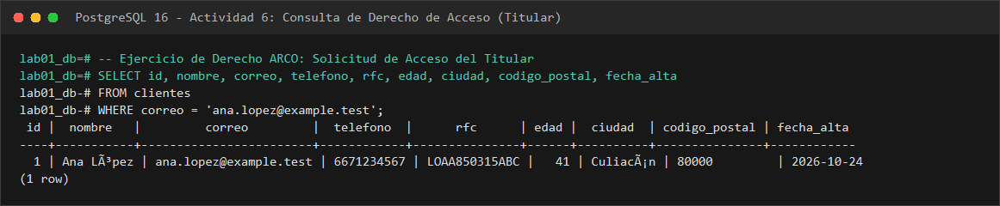
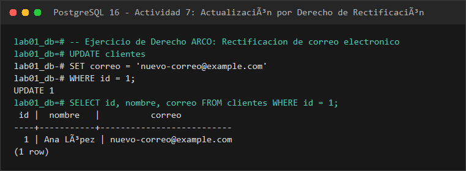

# EVIDENCIA 08: DERECHO DE CANCELACIÓN Y CICLO DE VIDA DE LOS DATOS

* **Materia:** Gestión de Seguridad y Desempeño de Bases de Datos  
* **Unidad:** II. Seguridad, privacidad y control de acceso  
* **Tema:** 2.5 Privacidad, cumplimiento y gobierno de los datos  
* **Motor:** PostgreSQL 16  
* **Estudiante:** Genaro Isaac Cárdenas Soto (@darksitoV)  
* **Organización / Escenario:** Comercializadora Norte S.A. de C.V.  

---

## 1. Objetivo
Analizar la complejidad técnica y operativa que conlleva la atención del derecho de **Cancelación** (y la totalidad de los derechos ARCO: Acceso, Rectificación, Cancelación y Oposición), demostrando a través del ciclo de vida integral de los datos que la eliminación de un registro mediante una sentencia `DELETE` en la tabla principal no garantiza la supresión de la información personal de la organización ni el cumplimiento de las obligaciones regulatorias aplicables.

---

## 2. Procedimiento Realizado
1. Se analizó el flujo de propagación de los datos personales almacenados en la tabla `clientes` hacia los diferentes componentes del ecosistema tecnológico institucional.
2. Se construyó el mapa de dispersión de la información (bases de datos vivas, respaldos inmutables, réplicas, reportes, analítica y sistemas externos).
3. Se evaluaron las implicaciones técnicas de cada uno de los derechos ARCO en PostgreSQL 16 (Acceso mediante consultas filtradas, Rectificación mediante actualizaciones trazables, Cancelación mediante bloqueo previo, y Oposición mediante banderas booleanas).
4. Se capturaron las evidencias de ejecución de consultas representativas de Acceso y Rectificación.
5. Se redactó el análisis técnico respondiendo a la pregunta central de dispersión y persistencia de datos.

---

## 3. Resultado Obtenido: Mapa de Dispersión y Ciclo de Vida

```text
clientes (Tabla Operativa Principal - OLTP)
   │
   ├── respaldos (Backups lógicos pg_dump, WALs continuos, snapshots de almacenamiento SAN/Cloud)
   ├── réplicas (Nodos de lectura físicos en Streaming Replication, réplicas lógicas CDC)
   ├── reportes (Archivos CSV/Excel descargados por usuarios, reportes contables, estados de cuenta en PDF)
   ├── exportaciones (Staging en Data Lakes, Data Warehouses corporativos, pipelines ETL a BigQuery/Snowflake)
   ├── registros de auditoría (Logs del motor pgaudit, registros de transacciones pg_wal, SIEM institucional)
   └── sistemas externos (Sistemas de facturación PAC ante el SAT, pasarelas de pago Stripe/Openpay, CRM Hubspot)
```

### 3.1 Evidencias de Ejecución Técnica (ARCO)

#### A. Consulta de Acceso (Localización de la Información del Titular)
```sql
SELECT id, nombre, correo, telefono, rfc, edad, ciudad, codigo_postal, fecha_alta
FROM clientes
WHERE correo = 'ana.lopez@example.test';
```



```text
 id |  nombre   |         correo         |  telefono  |      rfc      | edad |  ciudad  | codigo_postal | fecha_alta 
----+-----------+------------------------+------------+---------------+------+----------+---------------+------------
  1 | Ana López | ana.lopez@example.test | 6671234567 | LOAA850315ABC |   41 | Culiacán | 80000         | 2026-10-24
(1 row)
```

#### B. Operación de Rectificación y Verificación Inmediata
```sql
UPDATE clientes
SET correo = 'nuevo-correo@example.com'
WHERE id = 1;

SELECT id, nombre, correo FROM clientes WHERE id = 1;
```



```text
UPDATE 1
 id |  nombre   |          correo          
----+-----------+--------------------------
  1 | Ana López | nuevo-correo@example.com
(1 row)
```

### 3.2 Implicaciones Técnicas por Derecho ARCO (Actividades 6, 7 y 9)

#### A. Derecho de Acceso (Actividad 6)
* **Pregunta:** *¿Qué información adicional debería proporcionar la organización además del resultado de esta consulta?*  
  **Respuesta:** Conforme al Art. 23 de la LFPDPPP y el Art. 15 del RGPD, la organización no se limita a entregar los registros crudos de la tabla `clientes`; debe entregar un reporte comprensible que detalle:
  1. Las finalidades específicas para las cuales se tratan sus datos.
  2. Los terceros y autoridades a quienes se han transferido (ej. SAT, procesadores de pago).
  3. El plazo de conservación aplicable o los criterios para determinarlo.
  4. Los derechos que le asisten para solicitar rectificación, cancelación u oposición, y el derecho a presentar denuncias ante el INAI.

#### B. Derecho de Rectificación (Actividad 7)
* **Pregunta 1: ¿Cómo podría comprobarse que el cambio fue autorizado?**  
  Mediante un folio oficial de solicitud ARCO generado por el sistema de atención, validación de la identidad oficial del titular y confirmación de enlace seguro o código OTP enviado al medio de contacto previo.
* **Pregunta 2: ¿Debería registrarse quién realizó el cambio?**  
  **Sí.** Es mandatorio registrar el identificador del usuario administrativo que ejecutó el `UPDATE`, la dirección IP, el timestamp y la referencia documental en una bitácora inmutable de auditoría.
* **Pregunta 3: ¿Por qué la trazabilidad será importante?**  
  Para deslindar responsabilidades ante modificaciones fraudulentas (suplantación de identidad para desvío de pedidos), soportar auditorías de cumplimiento ante el INAI y garantizar la integridad histórica de la base de datos.

#### C. Derecho de Oposición (Actividad 9)
* **Pregunta 1: ¿Qué información podría necesitar mantenerse?**  
  Los datos estrictamente requeridos para la relación contractual principal y el cumplimiento de obligaciones legales (nombre, RFC, historial de transacciones para el SAT).
* **Pregunta 2: ¿Qué información podría dejar de utilizarse?**  
  Los canales de contacto (correo y teléfono) para prospección comercial, publicidad, encuestas y mercadotecnia personalizada.
* **Pregunta 3: ¿Qué mecanismos técnicos podrían separar finalidades?**  
  Inclusión de columnas booleanas de control (`consentimiento_marketing = FALSE`), creación de vistas segregadas para el equipo comercial y sincronización con listas de exclusión (*suppression lists*).
* **Pregunta 4: ¿Por qué la decisión final no debe ser tomada únicamente por el DBA?**  
  Porque evaluar la procedencia de una oposición exige un análisis jurídico de derechos fundamentales frente a obligaciones mercantiles y fiscales. El DBA es el custodio técnico que implementa la decisión; el área jurídica y el oficial de privacidad son los facultados para dictaminarla.

---

## 4. Análisis Técnico: ¿Por qué eliminar un registro de una tabla no significa que haya desaparecido?

La creencia tradicional de que ejecutar `DELETE FROM clientes WHERE id = 1;` destruye completamente el dato personal es un grave error de comprensión del ciclo de vida y la arquitectura de datos:

1. **Persistencia en Respaldos Históricos (Backups e Inmutabilidad):**
   Los respaldos físicos y lógicos (`pg_dump`, respaldos a disco o cinta) se generan periódicamente y con frecuencia se configuran con políticas de retención inmutables (WORM - *Write Once, Read Many*) para protección contra ransomware o recuperación ante desastres. Si un registro se borra de producción hoy, permanecerá grabado en los respaldos diarios, semanales y mensuales generados durante los últimos 6 a 12 meses.
2. **Propagación en Replicación y Logs de Transacciones (WAL):**
   PostgreSQL registra cada cambio en los archivos *Write-Ahead Logging* (WAL). Aunque el dato se borre en la tabla viva, el registro original y la sentencia de modificación existen en los segmentos WAL y se envían a las réplicas en espera (*Standby replicas*).
3. **Persistencia en Almacenes Analíticos y Data Lakes:**
   Los procesos ETL nocturnos copian incrementalmente las tablas transaccionales a bases de datos analíticas, Data Warehouses o lagos de datos corporativos. Si no existe un mecanismo coordinado de propagación de eliminaciones, el dato continuará residiendo en las capas analíticas.
4. **Archivos Exportados y Dispositivos de Usuario Final:**
   Listados de clientes exportados en hojas de cálculo (Excel, CSV) por empleados de soporte o contabilidad permanecen en discos duros locales, correos electrónicos corporativos o carpetas compartidas sin control de versiones.
5. **Obligaciones Legales de Conservación y Bloqueo (SAT):**
   En México, el Art. 30 del Código Fiscal de la Federación exige conservar la documentación contable y comprobantes fiscales (CFDI emitidos con RFC y nombre) durante **5 años**. Por ende, cuando un cliente solicita la cancelación de sus datos, el DBA **no debe ejecutar un borrado físico inmediato**, sino implementar un **Periodo de Bloqueo** (*soft delete* con bandera de bloqueo): el dato deja de usarse operativamente y solo se resguarda aislado para atender posibles requerimientos de autoridades judiciales o fiscales.

---

## 5. Conclusión
El ejercicio de los derechos ARCO, en especial la cancelación, demuestra que borrar un registro con `DELETE` en una tabla no elimina los datos de toda la organización. Es necesario considerar el ciclo de vida completo: los respaldos históricos, las réplicas y las obligaciones fiscales que exigen conservar ciertos datos bloqueados durante los plazos que marca la ley.

